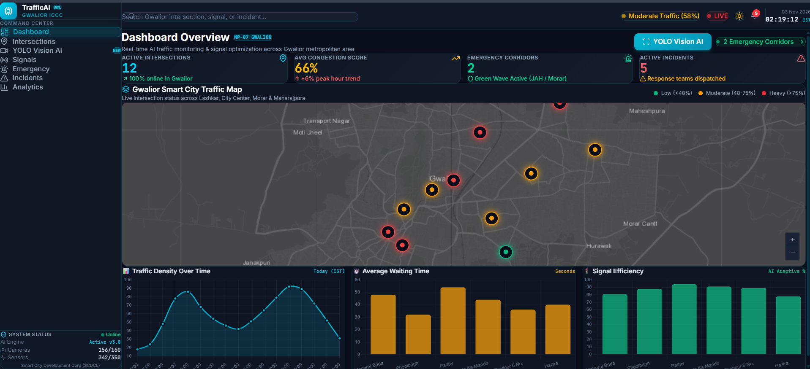
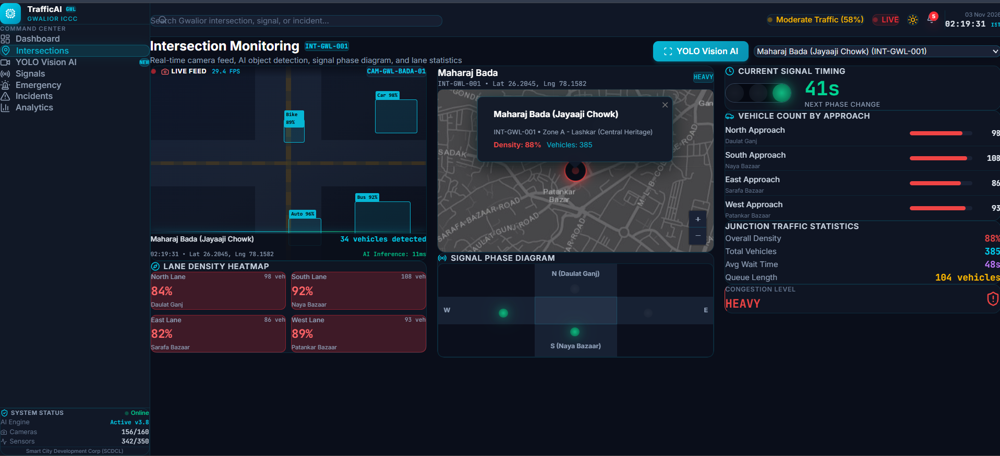
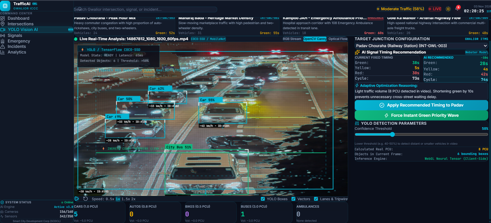
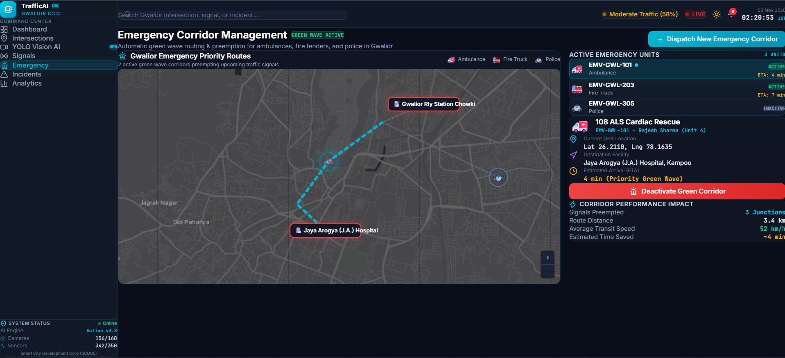
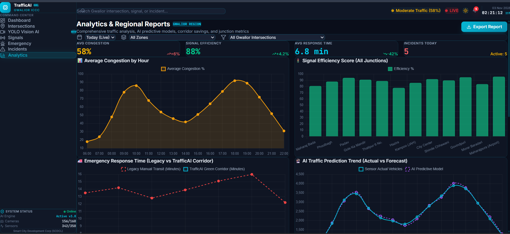

# TrafficAI – AI-Based Traffic Flow Analyzer

### A Smart Traffic Monitoring and Analysis System for Gwalior City

TrafficAI is an AI-based traffic analysis prototype designed to monitor vehicle movement, estimate traffic density, and support better traffic management through an interactive dashboard.

The project demonstrates how computer vision, data analysis, and interactive visualization can be combined to support smarter urban traffic monitoring.

---

##  Project Overview

Traffic congestion is a major challenge in urban areas. TrafficAI provides a centralized platform for analyzing traffic videos, identifying vehicles, estimating traffic conditions, and generating useful traffic-management recommendations.

The prototype is designed around selected traffic intersections in **Gwalior, Madhya Pradesh**.

---

##  Key Features

-  **Vehicle Detection** – Detects vehicles from uploaded traffic videos.
-  **Vehicle Classification** – Organizes detected vehicles into supported categories.
-  **Traffic Density Analysis** – Provides an indication of current traffic density.
-  **PCU Calculation** – Estimates traffic load using Passenger Car Unit (PCU) values.
-  **Interactive Traffic Map** – Displays configured traffic intersections in Gwalior.
-  **Signal Timing Recommendations** – Suggests traffic signal timing based on traffic analysis.
-  **Emergency Route Visualization** – Demonstrates possible emergency corridors and priority intersections.
-  **Analytics Dashboard** – Presents traffic information through a centralized interface.

---

##  System Workflow

```text
Traffic Video
     ↓
Video Frame Processing
     ↓
Vehicle Detection
     ↓
Vehicle Classification & Counting
     ↓
Traffic Density / PCU Analysis
     ↓
Traffic Recommendations
     ↓
Interactive Dashboard
```

---

##  Project Screenshots

### 1. Dashboard



### 2. Intersection Monitoring



### 3. YOLO Vision AI



### 4. Emergency Corridor Management



### 5. Analytics and Reports



---

##  Configured Traffic Locations

The prototype includes selected traffic locations in Gwalior, including:

- Maharaj Bada
- Phoolbagh
- Padav
- Gole Ka Mandir
- Thatipur
- Hazira
- Kampoo
- City Center
- Shinde Ki Chhawani
- Govindpuri
- Morar Baradari
- Maharajpura

---

##  Technologies Used

- React.js
- JavaScript
- Vite
- HTML5
- CSS3
- Computer Vision / Object Detection
- Data Visualization
- Interactive Maps

> **Note:** The exact AI detection model and backend technologies should be documented here only if they are implemented in the project.

---

##  Project Scope and Current Status

TrafficAI is currently a **prototype** demonstrating traffic analysis using uploaded videos and configured/sample traffic data.

The project is **not currently connected to live CCTV cameras or physical traffic signals**.

Signal timing and emergency-route features provide recommendations and visualizations rather than directly controlling real-world infrastructure.

If dashboard values are based on demonstration or sample data, they should be interpreted as prototype data rather than verified live traffic measurements.

---

##  Future Enhancements

- Integration with authorized live CCTV feeds
- Improved vehicle detection and tracking
- Real-time traffic monitoring
- Advanced traffic signal optimization
- Emergency vehicle priority integration
- Traffic congestion prediction
- Weather-based traffic analysis
- Improved privacy and security
- Historical traffic trend analysis
- Cloud-based traffic monitoring

---

##  Project Team

### Jaydeep Singh
**BTMC24O1061**

### Abhishek Pal
**BTMC24O1006**

### Project Guide

**Dr. D. K. Jain**  
Professor, Department of Applied Mathematics

**Madhav Institute of Technology & Science (MITS), Gwalior**

---

##  Academic Project

**Madhav Institute of Technology & Science (MITS), Gwalior**

This project demonstrates the application of **Artificial Intelligence, Computer Vision, Data Analysis, and Web Technologies** to an urban traffic-management problem.

---

##  Project Goal

> **TrafficAI – Exploring AI for smarter and more efficient urban traffic management.**

---